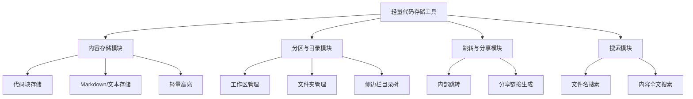

# 轻量级开发者代码/脑洞存储工具 需求文档
> 文档版本：V2.0（适配React技术栈）  
> 更新日期：2026年05月11日  
> 负责人：产品团队  
> 关联方：独立开发者、小规模开发团队、运维团队
> 定位说明：**Git/笔记软件的辅助补充工具，不替代Git的版本管理生态，核心解决开发者临时代码存储、脑洞记录、项目计划梳理的轻量化需求**
> 技术原则：**简洁使用React，不引入重型React生态依赖，保持轻量高性能**

---

## 一、文档修订记录
| 版本号 | 更新日期 | 更新内容 | 更新人 |
|--------|----------|----------|--------|
| V1.0   | 2026-05-11 | 初始版本，梳理核心需求框架 | 产品团队 |
| V2.0   | 2026-05-11 | 适配React技术栈，明确轻量使用React的约束 | 产品团队 |

---

## 二、项目概述
### 2.1 项目背景
当前开发者存在三类未被满足的轻量存储需求：
1.  **临时代码存储痛点**：Git操作复杂、仓库冗余，仅存临时可执行代码/片段时成本过高；印象笔记/石墨文档粘贴代码时加载高亮、格式转换卡顿，复制速度慢，且代码块容易被自动转格式破坏原有结构
2.  **脑洞/计划记录痛点**：现有笔记软件分区混乱，项目、代码、脑洞、TODO混在一起，检索定位效率低；缺少轻量的项目级目录结构，无法快速梳理小项目的逻辑
3.  **独立开发者友好度低**：主流工具要么功能冗余收费高，要么需要复杂配置，无法满足独立开发者「随手记、快速调、轻部署」的需求

### 2.2 项目目标
| 目标类型 | 具体指标 |
|----------|----------|
| 体验目标 | 粘贴代码响应时间≤200ms，复制无卡顿无冗余格式，新用户10秒上手 |
| 功能目标 | 实现三级分区+目录树定位、内部跳转、分享链接跳转核心功能，存储结构清晰度提升80% |
| 技术目标 | 前端打包体积≤1M，页面加载速度≤1s，无冗余React依赖拖慢性能 |
| 部署目标 | 支持本地免部署运行，也支持一键Docker部署，无复杂依赖 |
| 定位目标 | 明确为Git/笔记软件的补充工具，不做版本管理、团队协作等重型功能 |

### 2.3 项目范围
#### 2.3.1 本次迭代包含范围
- 基础内容存储（代码块、Markdown、纯文本）
- 三级分区体系（工作区→文件夹→文件）
- 侧边栏目录树（融合石墨文档目录机制，支持快速定位）
- 内部跳转能力（支持`#+文件名`快捷跳转）
- 分享链接能力（支持单文件/文件夹/工作区分享，点击直接跳转）
- 轻量代码高亮（无冗余渲染，不影响复制/粘贴速度）

#### 2.3.2 本次迭代不包含范围
- Git版本管理、分支、PR等协作功能
- 重型笔记功能（比如思维导图、文档协作、复杂表格）
- 付费会员体系、云存储同步（V1.0仅支持本地存储）

### 2.4 术语定义
| 术语 | 说明 |
|------|------|
| 工作区 | 最高级分区，对应印象笔记的「笔记本」，比如「个人项目」「工作代码」「脑洞库」 |
| 文件夹 | 二级分区，对应石墨文档的「目录」，比如工作区下的「AI工具项目」「Python脚本」 |
| 内部跳转 | 在当前工作区内通过`#+文件名/锚点`快速跳转到对应文件/位置的能力 |
| 分享链接 | 生成可公开访问的链接，打开后直接定位到对应文件/文件夹 |

---

## 三、用户角色与权限
| 角色名称 | 角色说明 | 核心权限 |
|----------|----------|----------|
| 个人开发者 | 独立使用工具的用户 | 创建/编辑/删除自己的工作区、文件夹、文件，生成分享链接 |
| 小团队用户 | 3人以内小团队共用 | 创建共享工作区，团队成员可编辑共享工作区内的内容，支持权限隔离 |

---

## 四、功能需求
### 4.1 功能模块总览

### 4.2 各模块详细需求
#### 4.2.1 内容存储模块（优先级P0）
| 功能点ID | 功能名称 | 优先级 | 需求描述 | 验收标准 |
|----------|----------|--------|----------|----------|
| FUNC-001 | 多格式内容存储 | P0 | 支持存储三类内容： 1. 代码块：粘贴代码自动识别语言，不自动转格式，保留原始缩进 2. Markdown文本：支持基础Markdown语法（标题、列表、链接、代码块） 3. 纯文本：无格式快速记录 | 1. 粘贴1000行代码响应时间≤200ms，无卡顿 2. 代码粘贴后不自动转富文本，保留原始结构 3. 支持一键切换「编辑模式/预览模式」 |
| FUNC-002 | 轻量代码高亮 | P0 | 仅预览模式下加载轻量高亮，采用Prism.js等轻量库，不占用编辑/复制性能 | 1. 编辑模式下无高亮加载，粘贴/复制无卡顿 2. 预览模式下代码高亮加载速度≤100ms 3. 复制代码时可选择「复制原始代码/复制带高亮的文本」 |
| FUNC-003 | 快速保存 | P0 | 支持快捷键Ctrl+S快速保存，也支持自动保存（编辑后1s自动存） | 1. 保存成功率100%，无内容丢失 2. 保存过程无弹窗、无卡顿 |

#### 4.2.2 分区与目录模块（优先级P0）
| 功能点ID | 功能名称 | 优先级 | 需求描述 | 验收标准 |
|----------|----------|--------|----------|----------|
| FUNC-004 | 三级分区体系 | P0 | 采用「工作区→文件夹→文件」三级结构，融合印象笔记分区+石墨目录机制： 1. 工作区：最高级分类，比如「个人项目」「代码片段」「脑洞库」 2. 文件夹：工作区下的二级分类，支持无限层级嵌套 3. 文件：最小存储单元，单个文件支持代码、Markdown、纯文本 | 1. 支持右键新建/重命名/删除工作区、文件夹、文件 2. 支持拖拽调整文件/文件夹的所属关系 3. 单个工作区支持最多10000个文件，满足个人/小团队使用 |
| FUNC-005 | 侧边栏目录树 | P0 | 左侧固定侧边栏显示当前工作区的目录树，支持折叠/展开，实时同步文件变动 | 1. 目录树加载速度≤100ms，无卡顿 2. 支持快捷键Ctrl+Shift+F快速聚焦目录搜索框 3. 当前打开的文件在目录树中高亮显示 |
| FUNC-006 | 标签系统 | P1 | 支持给文件/文件夹打标签，支持跨分区检索 | 1. 单个文件/文件夹支持最多10个标签 2. 支持按标签过滤文件列表 |

#### 4.2.3 跳转与分享模块（优先级P0）
| 功能点ID | 功能名称 | 优先级 | 需求描述 | 验收标准 |
|----------|----------|--------|----------|----------|
| FUNC-007 | 内部跳转 | P0 | 支持两种内部跳转规则： 1. Markdown原生锚点：支持`[跳转到登录模块](#login-module)`语法，点击跳转到当前文件对应锚点位置 2. 快捷跳转指令：输入`#`后自动弹出当前工作区下的文件列表，选中后自动插入跳转链接，支持相对路径跳转（比如`#../前端项目/utils.js`跳转到其他文件夹的文件） | 1. 输入`#`后文件列表弹出响应时间≤100ms 2. 点击跳转链接后自动滚动到对应位置，或在目录树中高亮对应文件 3. 支持跳转链接带行号参数，比如`#utils.py:10`直接跳转到第10行 |
| FUNC-008 | 分享链接跳转 | P0 | 支持生成三种粒度的分享链接，点击后直接跳转对应位置： 1. 单文件分享：打开直接定位到该文件 2. 文件夹分享：打开直接显示该文件夹的目录树 3. 工作区分享：打开直接显示整个工作区的目录树 | 1. 链接生成速度≤100ms 2. 支持设置分享权限：私密/公开、过期时间（1天/7天/永久）、访问密码 3. 分享内容加载速度≤1s |

#### 4.2.4 搜索模块（优先级P1）
| 功能点ID | 功能名称 | 优先级 | 需求描述 | 验收标准 |
|----------|----------|--------|----------|----------|
| FUNC-009 | 全局搜索 | P1 | 支持按文件名、标签、内容全文搜索，搜索结果高亮匹配关键词 | 1. 搜索响应时间≤500ms，支持10000个文件内的全文检索 2. 支持按工作区/文件夹筛选搜索结果 3. 支持快捷键Ctrl+K快速唤起搜索框 |

---

## 五、非功能需求
### 5.1 性能需求
- 前端基于React+Vite构建，打包体积≤1M，页面加载速度≤1s
- 粘贴代码、复制内容、跳转操作无卡顿，响应时间≤200ms
- 代码编辑区域使用原生`textarea`实现，避免React重渲染影响粘贴/输入性能，高亮组件仅在预览模式渲染，编辑模式完全卸载
- 本地模式下单文件最大支持10M，满足绝大多数代码片段/项目计划存储需求

### 5.2 安全需求
- 本地模式下数据默认加密存储，无需上传第三方服务器
- 分享链接支持加密传输，敏感内容可设置访问密码
- 支持操作日志，所有编辑/删除/分享操作可追溯

### 5.3 兼容性需求
- 支持Web端运行：兼容Chrome/Edge/Safari最新2个版本
- 支持本地运行：双击启动包即可运行，无需安装Node.js等环境
- 支持Docker一键部署，适配主流云服务器

### 5.4 可用性需求
- 本地模式无网络也能正常使用，数据存储在本地SQLite文件中
- 支持数据导出，可导出为Markdown/PDF/代码文件包，避免数据丢失
- 操作无广告、无冗余弹窗，界面极简

---

## 六、技术栈选型（简洁使用React原则）
> 选型核心：不引入重型React生态依赖，仅用必要轻量库，保证性能轻量
| 层级 | 技术选型 | 选型理由 |
|------|----------|----------|
| 前端 | React 18 + Vite + TailwindCSS + Zustand | 1. Vite构建速度快、打包体积小，无Create React App等重型模板的冗余配置 2. TailwindCSS快速实现极简UI，无需写大量自定义CSS，避免引入AntD/MUI等重型UI组件库 3. Zustand轻量状态管理，比Redux等方案学习成本低、体积小，仅用于管理分区、文件状态等核心数据 4. 代码编辑区域用原生textarea实现，避免React重渲染影响粘贴性能 |
| 后端 | Python + FastAPI | 轻量、开发效率高、生态丰富，适合快速迭代，仅用于分享链接生成、权限校验等非核心逻辑，本地模式可完全离线运行 |
| 数据库 | SQLite | 轻量、无需单独部署，本地存储零依赖，适合个人/小团队使用 |
| 代码高亮 | Prism.js | 轻量、加载快，仅在预览模式渲染，不影响编辑/复制性能 |
| 部署 | Docker / PyInstaller + Vite打包 | 支持一键部署，也支持打包为桌面客户端，双击即可运行，无需装环境 |

### 6.1 React使用约束
1.  禁止引入重型React组件库（如AntD、MUI、Arco Design等），所有UI组件基于TailwindCSS原生实现
2.  仅引入必要的小型工具库，总依赖体积控制在500KB以内
3.  高频交互区域（如代码编辑区、目录树）尽量减少React状态更新，避免不必要的重渲染

---

## 七、验收标准
1.  所有P0级功能全部实现，P1级功能实现率不低于80%
2.  粘贴代码、复制、跳转等核心操作无卡顿，响应时间符合性能要求
3.  三级分区+目录树结构清晰，可快速定位文件，存储混乱问题得到解决
4.  内部跳转、分享链接跳转功能正常，无死链、跳转错误
5.  前端打包体积≤1M，页面加载速度≤1s，本地模式无需安装依赖即可运行
6.  部署成本符合预期，单机部署时间≤5分钟

---

## 八、项目里程碑计划
| 里程碑节点 | 计划完成日期 | 交付物 | 负责人 |
|------------|--------------|--------|--------|
| V1.0核心版本 | 2026-05-25 | 支持本地运行的基础版本，包含所有P0功能 | 开发团队 |
| V1.1优化版本 | 2026-06-08 | 支持分享链接、全局搜索、标签系统 | 开发团队 |
| V1.2完整版本 | 2026-06-22 | 支持桌面客户端、数据导出、版本快照 | 开发团队 |
| 公开测试 | 2026-07-06 | 开放给少量独立开发者测试，收集反馈 | 产品团队 |

---

## 九、风险与应对预案
| 风险描述 | 风险等级 | 应对方案 |
|----------|----------|----------|
| React引入过多冗余依赖导致打包体积大、性能差 | 中 | 严格限制React生态依赖，仅引入必要的小型库，UI全部用TailwindCSS原生实现，代码粘贴区域用原生DOM元素避免React重渲染，打包体积控制在1M以内 |
| 用户误以为工具可替代Git | 中 | 产品界面明确标注「辅助存储工具，不替代Git」，文档明确说明定位差异 |
| 分享链接权限被绕过 | 低 | 分享链接的访问权限校验全部在后端完成，前端仅做展示，敏感内容强制后端校验密码 |

---

## 十、附录
- 参考工具：印象笔记、石墨文档、GitHub Gist、Notion
- 核心痛点参考：独立开发者社区关于「临时代码存储难」「笔记软件粘贴代码卡」的相关讨论
- 后续迭代方向：WebDAV同步、团队协作、插件系统、AI代码片段整理等